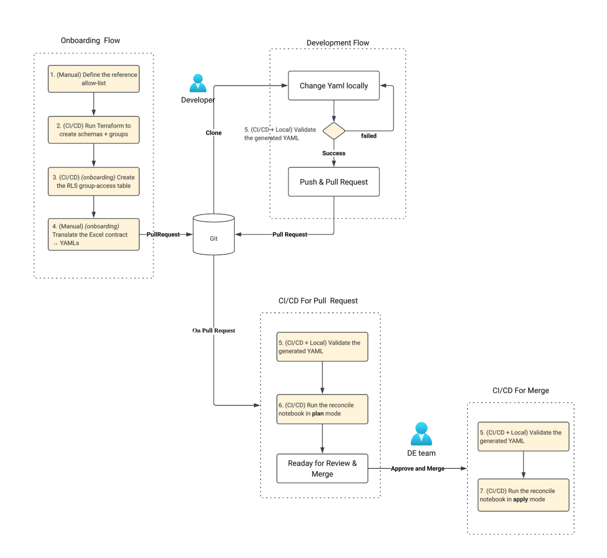

### Prerequists
1. **Target catalog `hera-dev` exists.** Terraform references it by name and does
   not create it. CI/CD needs `USE CATALOG` + `CREATE SCHEMA` on it.
2. **Source schemas + base tables exist** in `hera-dev.gold` /
   `hera-dev.silver` (the dynamic views read from them).

3. **RLS entitlement tables prepared** — the customer authors and maintains `hera-dev.governance.entitlements` (per-group scope on each axis) and `hera-dev.governance.entitlement_mapping` (axis value → `portfolio_code`). The framework only **reads** them to derive the `group_portfolio_access` MV (step 3).

4. **Entra ID groups created** — **required only when `entra_linked_groups = true`** (the
   Terraform default; AIM is enabled). 
   
   - Each `hera-*` account group is linked to its Entra group by `external_id`, resolved by display-name lookup. 
   - A group **missing or ambiguous** in Entra **fails the plan** (fail-closed). 
   - The `dev` path with `entra_linked_groups=false` needs no Entra and no `az login`.
       - In `dev` groups are created locally.
5. **AIM** is enabled
6. **Auth / CLI profiles** for Terraform (three providers):
   - workspace `databricks` → `-var databricks_profile=…` (default `xieming-azure`) — catalog lookup + schemas.
   - account `databricks.account` → `-var databricks_account_profile=…` (default `azure-account-ccb842e7`, must be an **account-level** profile) — group creation.
   - `azuread` → `az login` (or an SP via the AzureAD env vars) — **only when `entra_linked_groups=true`**.
7. **Python env (Local Dev・CI/CD)** 
   - `generate` / `validate`: `pip install -r requirements.txt` (`jsonschema`, `PyYAML`, `openpyxl`, …). 
   - `pyspark` is **not** needed for generate/validate; it is provided by the Databricks runtime for the notebooks. 


### The three config layers

1. **Reference allow-list** — `config/reference/esg.yaml`. Hand-curated by governance; the
   - **single source of truth** for `target_catalog`, the approved vocabulary (groups, schemas, data products, governed tags).
       - The configuration here will be used to check the vocabulary (groups, schemas, data products, governed tags), 
       - The full-sync **protected set**, the **mask-exempt (ETL)** principals, and the **RLS entitlement table**. Terraform, the validator, and the reconcile notebook all read this *same* file.
2. **Generated config** — `config/esg/*.yaml` (`base_grants`, `labels`, `tags`, `policies`, `rbac_view_grants`, `rbac_views`).        
   - Produced *from the Access-Matrix workbook* by `framework.generate`. This is the **fail-closed** JSON-Schema-validated desired state.
3. **Git SQL objects** — `sql/<env>/*.sql` in the **configs repo** (deployment content, not part of the wheel; one idempotent `CREATE OR REPLACE` per file): the `acm_mask_*` mask UDFs and the `group_portfolio_access` RLS materialized view. The wheel only renders them (`${catalog}` / `${governance_schema}` / `${unmasked_condition}` from the reference).


### The two notebooks

| Notebook | Purpose | Trigger | Compute |
|---|---|---|---|
| `notebooks/apply_functions.py` | Applies every `*.sql` in its `sql_path` (the configs repo's `sql/<env>/`, `CREATE OR REPLACE`) — the mask UDFs **and** the `group_portfolio_access` MV. | CI/CD on changes under **`sql/**`** (path-filtered). | **Serverless** required for the MV (Pro/Serverless SQL warehouse, or serverless general compute on DBR 18.1+). |
| `notebooks/reconcile.py` | Compiles `config/esg` → target state, diffs vs. live, and (in `apply`) executes grant/tag/policy deltas + ensures dynamic views. | CI/CD on config changes. | **ABAC-capable compute** required for column-mask policy DDL. |

---

### Steps:
#### 1. (Manual) Define the reference allow-list

Edit **`config/reference/esg.yaml`** — the authoritative, hand-curated per-deployment source
of truth. Confirm:

- `target_catalog: hera-dev`
- `groups:` — the 6 account groups the matrix may grant to (`hera-all-esg-read-unmasked`,
  `hera-all-esg-read-masked`, `hera-sg-esg-read-masked`, `hera-sg-eq-read-masked`,
  `hera-sg-fi-read-masked`, `hera-all-admin-admin-unmasked`).
- `governance_schemas` / `source_schemas` / `serving_schemas` — Terraform creates the
  **union of governance + serving** (`source_schemas` are deliberately excluded as DE-owned).
- `protected_principals` (`deployers`, `admin_groups`) + `protected_schemas` — the full-sync
  guardrail (never REMOVE / never touch).
- `mask_exempt_principals` — ETL/pipeline identities added to every mask policy's `EXCEPT`.
- `rls_entitlement_table: hera-dev.governance.group_portfolio_access` + `rls_group_column: ad_group`.

> This file is **not** generated from the workbook — the workbook is validated *against* it.

---

####  2. (CI/CD) Run Terraform to create schemas + groups

```bash
cd terraform
terraform init

# Standard (AIM / Entra-linked — the default). Needs Entra groups + `az login`:
terraform plan  -var env=esg
terraform apply -var env=esg

# Dev / local (plain local account groups — no Entra, no az login).
# This is the retired `seed_esg_groups.sh` path:
terraform plan  -var env=esg -var entra_linked_groups=false
terraform apply -var env=esg -var entra_linked_groups=false
```

`env` defaults to `esg`, so `-var env=esg` can be omitted. Terraform creates the schema (governance + serving) under the **pre-existing** catalog and the account groups. Expected output for this deployment:

```text
Changes to Outputs:
  + catalog = "hera-dev"
  + groups  = {
      + hera-all-admin-admin-unmasked = null   # external_id null in local mode;
      + hera-all-esg-read-masked      = null   # = resolved Entra object id when
      + hera-all-esg-read-unmasked    = null   #   entra_linked_groups = true
      + hera-sg-eq-read-masked        = null
      + hera-sg-esg-read-masked       = null
      + hera-sg-fi-read-masked        = null
    }
  + schemas = [
      + "dm_esg",
      + "dm_something",
      + "governance",
    ]
```

---

#### 3. (CI/CD) *(onboarding)* Create the RLS group-access table

**What "RLS Group Access Table" means:** the `group_portfolio_access` **materialized view** (`sql/<env>/group_portfolio_access.sql` in the configs repo) — the group → `portfolio_code` allow-list the dynamic RLS views semi-join against. It is **derived** from two **customer-owned** source tables, `hera-dev.governance.entitlements` and `hera-dev.governance.entitlement_mapping`.

**Order of operations:**

1. **Ensure the source entitlement tables exist and are populated.**
   - customer-owned — the customer authors/maintains the group scopes and the attribute→`portfolio_code` mapping. The framework only reads them.
2. **Create the MV** by running **`notebooks/apply_functions.py` in `apply` mode**. This applies **all** `*.sql` in `sql_path` idempotently — i.e. the `group_portfolio_access` MV **and** the `acm_mask_*` UDFs that step 7's column-mask policies depend on.
   - On **serverless notebook (job) compute**, creating the MV needs the workspace preview *Serverless Generic Compute Materialized View/Streaming Table*. Without it the MV fails with `MV_NOT_ENABLED_ON_SERVERLESS_GENERIC_COMPUTE` (the UDFs still succeed; the run fails). A SQL warehouse can create it without the preview (seen 2026-10-23 on adb-7405618647360901).

##### RLS Example — how `group_portfolio_access` is derived

`(Customer Maintained, Input Table 1/2)`
**`hera-dev.governance.entitlements`** — per-group scope on each axis:


| `ad_group` | scope (`type`=`value`) |
|---|---|
| `hera-all-esg-read-unmasked` | `region=*`, `team=*` |
| `hera-all-esg-read-masked` | `region=*`, `team=*` |
| `hera-sg-esg-read-masked` | `region=EISG`, `team=*` |
| `hera-sg-eq-read-masked` | `region=EISG`, `team=EQ` |
| `hera-sg-fi-read-masked` | `region=EISG`, `team=FI` |

*(Stored as one row per `type` — so each group above is 2 rows: `(ad_group, tag, type, value)`.
10 rows total; `hera-all-admin-admin-unmasked` has none; see the note below.)*

`(Customer Maintained, Input Table 2/2)`
**`hera-dev.governance.entitlement_mapping`** — which `portfolio_code` carries each axis value:

| `type` | `value` | `portfolio_code` |
|---|---|---|
| region | `EISG` | PF_EQ_1, PF_EQ_2, PF_FI_1 |
| region | `AMER` | PF_OTHER |
| team | `EQ` | PF_EQ_1, PF_EQ_2 |
| team | `FI` | PF_FI_1 |
| team | `OTHER` | PF_OTHER |

A group reaches a code on an axis if its value is `*` (every code on that axis) **or** the code carries that value; the MV keeps only codes reached on **both** axes (region ∩ team), failing closed if a group is missing an axis. Result:

`Derived Table from Input 1 and 2`
**`hera-dev.governance.group_portfolio_access`** (derived — 14 rows):

| `ad_group` | region reach | team reach | **`portfolio_code` (region ∩ team)** |
|---|---|---|---|
| `hera-all-esg-read-unmasked` | all 4 | all 4 | PF_EQ_1, PF_EQ_2, PF_FI_1, PF_OTHER |
| `hera-all-esg-read-masked` | all 4 | all 4 | PF_EQ_1, PF_EQ_2, PF_FI_1, PF_OTHER |
| `hera-sg-esg-read-masked` | PF_EQ_1, PF_EQ_2, PF_FI_1 | all 4 | PF_EQ_1, PF_EQ_2, PF_FI_1 |
| `hera-sg-eq-read-masked` | PF_EQ_1, PF_EQ_2, PF_FI_1 | PF_EQ_1, PF_EQ_2 | PF_EQ_1, PF_EQ_2 |
| `hera-sg-fi-read-masked` | PF_EQ_1, PF_EQ_2, PF_FI_1 | PF_FI_1 | PF_FI_1 |

Each RLS dynamic view (those with an `rls_column`, e.g. `dm_esg.fact_portfolio_position`) then
filters as the querying user:

```sql
WHERE portfolio_code IN (
  SELECT portfolio_code FROM `hera-dev`.governance.group_portfolio_access
  WHERE is_account_group_member(ad_group))
```


> **Compute:** creating/refreshing the MV **requires serverless** compute — not a classic cluster. The MV is `TRIGGER ON UPDATE`, so it auto-refreshes (min ~1 min) when the source tables change; row tracking is enabled on the source tables for efficient incremental refresh.


---
#### 4. (Manual) *(onboarding)* Translate the Excel contract → YAMLs

Input contract: **`excels/esg/access-matrix-esg_workshop-v3-dynamic-views.xlsx`**
(the signed-off copy is `excels/esg/access-matrix-esg_workshop-v3-dynamic-views.xlsx`).

The generator reads these workbook sheets (all required): **Groups, Data Products, Base Tables, Base Grant Rules, Base Grant Exceptions, Permission Bundles, Rbac Views, Asset Classification, Masking Rules**. It converts them to asset-level labels + grants (with valid empty tag/policy stubs), **self-validates**, and writes the config directory.

**Validate only** (`--check` — prints a summary, writes nothing):
```bash
python -m framework.generate.cli excels/esg/access-matrix-esg_workshop-v3-dynamic-views.xlsx config/esg --check
```

**Validate then generate** (writes `config/esg/*.yaml`):
```bash
python -m framework.generate.cli excels/esg/access-matrix-esg_workshop-v3-dynamic-views.xlsx config/esg
```

Exit code `0` on success, `1` on any generation/validation failure. Output names:
`base_grants.yaml`, `labels.yaml`, `tags.yaml`, `policies.yaml`, `rbac_view_grants.yaml`, `rbac_views.yaml`. 

Review and commit the diff.

---

#### 5. (CI/CD + Local) Validate the generated YAML

```bash
ucgov-validate config/esg --reference reference/esg.yaml --sql sql/esg   # add -v to list every check performed
```

Fail-closed JSON-Schema + semantic validation of `config/esg`, plus the reference allow-list check (groups / schemas / data products / tags). `--reference` is required; a missing or unreadable reference file is an error. Exit `0` when there are no issues, `1` otherwise — warnings fail too, unless `--skip-warning` is given.

This process is expected to happen in three places:
 - Local machine of develop for a quick offline check
 - CI/CD pipeline as gated check 
 - The reconcile notebook re-runs this same validation at runtime, and additionally layers the reference allow-list warnings — see step 6.

---

#### 6. (CI/CD) Run the reconcile notebook in **plan** mode

Run **`notebooks/reconcile.py`** with widgets:

- `config_path` → the workspace path to `config/esg`
  (e.g. `/Workspace/Users/<you>/eastspring-governance/config/esg`).
- `reference_path` → **required**: the workspace path to the reference allow-list
  (e.g. `/Workspace/Users/<you>/eastspring-governance/config/reference/esg.yaml`). It is never
  derived from `config_path`; empty / missing / unreadable stops the notebook before anything runs.
- `mode` → **`plan`** (default).

In `plan` mode the notebook:
1. Loads `config/esg` (`config_path`) + the reference allow-list (`reference_path`).
2. **Re-validates** the config (fail-closed; raises on error) and reports reference warnings (fail-open).
3. Compiles → target state (grants / tags / policies + referenced objects), reads **live** state from `information_schema` (+ `SHOW POLICIES`), and emits a **per-dimension delta** (ADD / REMOVE / CHANGE) honoring the **protected set** (deployer + `admin_groups` + protected schemas, never REMOVE).
4. **Previews** the dynamic-view DDL and the grant/tag/policy SQL — **executes nothing**.

Review the delta carefully. Note the **full-sync** semantics: any live grant in `hera-dev` not declared in the YAML is a proposed **REMOVE** (except protected); `acm_*` tags and `acm_policy_*` policies are likewise synced.

---

#### 7. (CI/CD) Run the reconcile notebook in **apply** mode

Re-run `notebooks/reconcile.py` with `mode = apply`. This executes:
- **Dynamic views:** `CREATE OR REPLACE` every expected view (RLS semi-join when `rls_column` is set, else pass-through), creates missing serving schemas, and **drops** serving-schema views not in the matrix (ensure-all / idempotent).
   - No matter if the view is updated or not, it will be re-created because there is no quick way to detect if the view is changed.
- **Grants / tags / policies:** the delta as `GRANT` / `REVOKE` / `ALTER … SET/UNSET TAGS` /
  `CREATE OR REPLACE | DROP POLICY`.
- **Order — tighten first, loosen last**, so data is never readable unmasked while it changes:
  1. **masking**: policies ADD/CHANGE, then tags ADD/CHANGE
  2. **views**: the dynamic views above (a new view is readable at once through the serving schema's schema-level grant, so its masks must already be in place)
  3. **access**: grants ADD, then REMOVE
  4. **loosen**: UNSET tags, then DROP policies
   - If a masking statement fails, nothing after it runs (`SKIPPED`). Any `FAILED` / `SKIPPED` statement fails the notebook (and so the job and the pipeline step).

---
